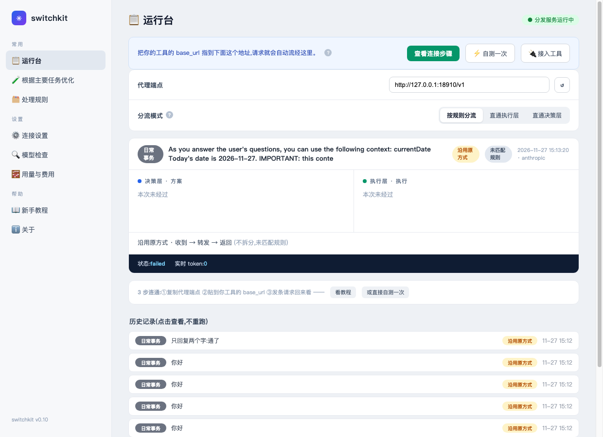
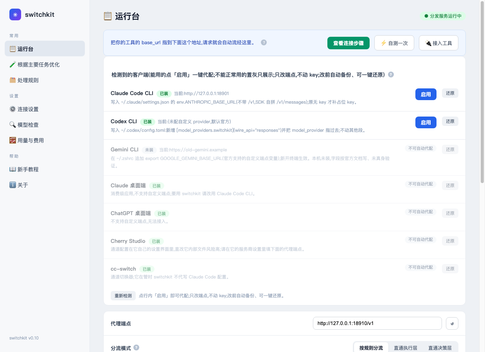
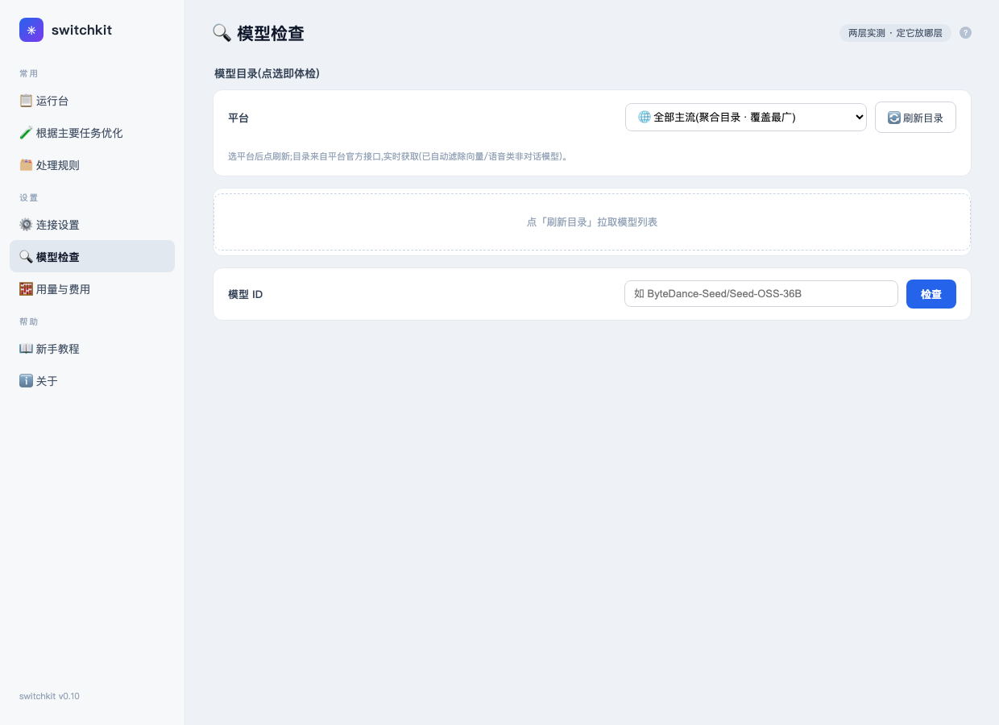

# switchkit — 双层分发台

把[决策层想、执行层做]的双层分工做成**无感代理**:任何能改 base_url 的 AI 工具把请求指过来,switchkit 按处理规则决定走「双层分工」还是「沿用原方式」。请求从哪来、走哪条路、用了多少 token,运行台全程可见。本机回环运行,BYOK。

## 诚实定位(先读)

- **不做自动择优**:2026-11-25 盲测按类择优映射未过线(赢面 0.40<0.60,双评同向),本工具只做分工与分流,**不宣称替你选模型**。
- **BYOK**:只存 key 的**文件路径**(或平台约定的 key 文件),不存明文、不上传、不代付、无服务器。
- **打分口径(2026-11-27 定)**:处理规则的「对比分」没有初始值——由你选好模型、验证后主动「按当前模型打分」(试跑对比)产生;**分绑打分时的两层模型,换模型即失效、须重打**;未打分/已过期的规则不能启用,分流内核也不认。
- **第三方配置口径(2026-11-27 改)**:原「不碰任何第三方配置」修订为——运行台「🔌 接入工具」可代写第三方工具的**端点字段**(只动端点、不动 key),前提三件套:**改前留带时间戳的备份、弹窗逐项确认、一键还原**;未装/不支持自定义端点/被其他通道管理器占管的只展示不代写。
- **代配成功 ≠ 一定连通**:以客户端自测为准;Gemini 的写入字段按官方 `GOOGLE_GEMINI_BASE_URL` 文档,本机未装、未真身验证。

## 快速开始

```bash
python3 switchkit.py serve --port 8787     # 起本机服务并开浏览器
# 桌面版:pyinstaller switchkit.spec → dist/switchkit.app
```

四步用起来:①「连接设置」配两层(base_url / 模型 ID / key 文件路径)→ ②「模型检查」点选模型,两层实测打分、按推荐填入对应层 → ③「处理规则」按当前模型打分,启用要走机制的工作类型 → ④ 工具侧把 base_url 指到运行台的代理端点(或用「🔌 接入工具」一键代配),发条请求回运行台看路线。

## 界面一览

| 运行台 | 接入工具(灰=不可用) | 模型检查 |
|---|---|---|
|  |  |  |

> 支持深链直达:`?panel=check` 等(可选值 log/opt/tpl/cfg/check/meter/guide/about)、`?clients=1` 展开接入工具。

## 架构一页

- **单文件** `switchkit.py`:stdlib `http.server` + 内嵌前端;管理 UI 与代理同端口。
- **协议适配**(同一分流内核,只转文本、不转工具调用):`POST /v1/chat/completions`(OpenAI 系)、`/v1/messages`(Anthropic 系,含 stream→SSE)、`/v1/responses`(Codex 现行 wire_api 只认这个,含 stream→SSE)、`/v1beta/models/*:generateContent`(+stream,Gemini 系)。
- **分流内核**:识别五类工作(代码/写作/分析/问答/通用)→ 查处理规则(**只认有效分且启用的行**)→ 双层分工(决策层出规格→执行层出成品)或沿用原方式原样转发。
- **客户端接入**:检测本机 Claude Code CLI / Codex CLI / Gemini CLI(可代配)与 Claude 桌面端 / ChatGPT / Cherry Studio / cc-switch(只展示);端点写法随协议而异:Claude 系 base 不带 /v1、Codex provider 带 /v1、Gemini 的环境变量不带 /v1。
- **数据**:全部落 `~/.config/switchkit/`(双层配置、用量账、事件日志、规则);`exclude_map.json` 为带出处的已知风险参考数据(界面已不展示判定)。


## License

MIT(见 `LICENSE`)。欢迎提 issue / PR;
